# Cupertino for YAQMC

An Apple-inspired redesign of [YAQMC](https://github.com/YAQMC/YAQMC) with three deliberately different
layout systems: **macOS** on desktop, **iOS** on phones, **iPadOS** on tablets. Each comes in two styles:
**Classic** (solid, quiet chrome) and **Liquid Glass**, switched with YAQMC's own
**Settings → Appearance → Material**.

Two packages:

| Package | What it is |
| --- | --- |
| `dev.cupertino.yaqmc` — **Cupertino** | The whole redesign and the lyrics scene. Stylesheets only, no script. |
| `dev.cupertino.yaqmc.now-playing` — **Cupertino Now Playing** | Optional. A Now Playing page and the Home arrangement setting. Script only, no styles. |

They are split on purpose: YAQMC 0.1.1 deletes a plugin's stylesheets when it starts that plugin's script
(see [Compatibility](#compatibility)), which is why 1.0.0, one package with both, showed only its Now
Playing entry and none of the redesign.

| Desktop — macOS | Tablet — iPadOS | Phone — iOS |
| --- | --- | --- |
| 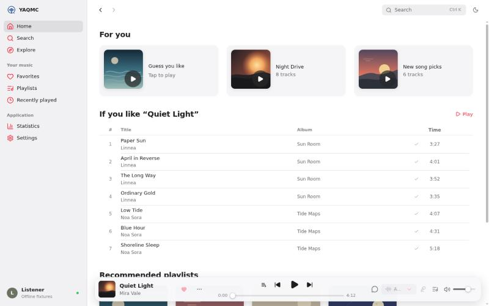 | 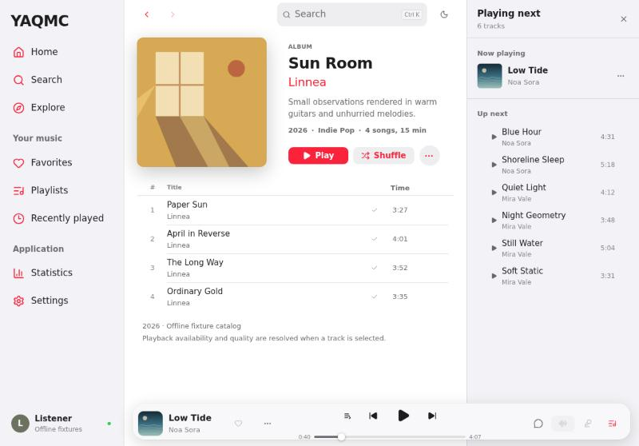 | 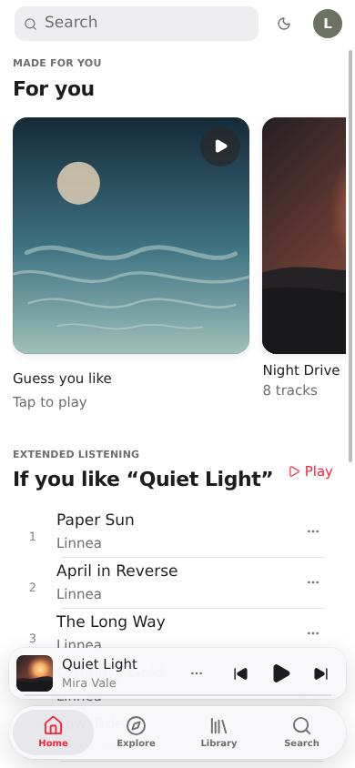 |

**Liquid Glass**

| Desktop | Tablet | Phone |
| --- | --- | --- |
| 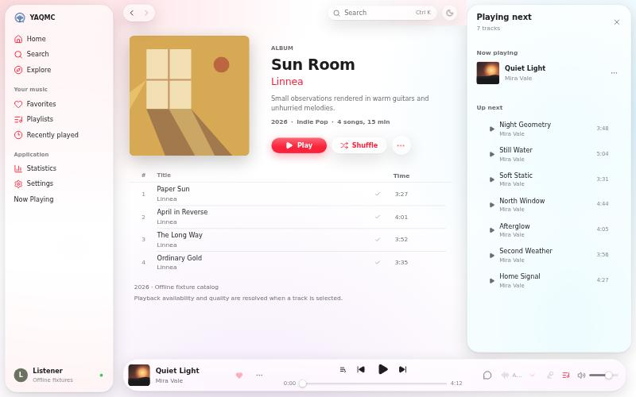 | 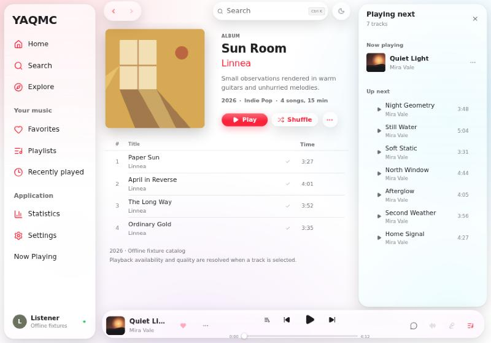 | 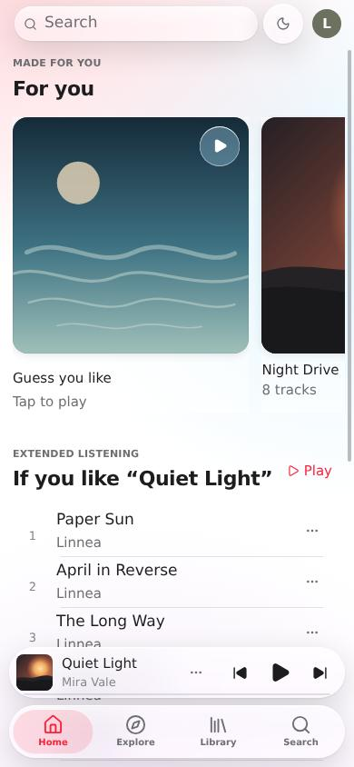 |

<details>
<summary>More screenshots</summary>

**Liquid Glass** — dark desktop, dark Settings, tablet Now Playing, phone playlist

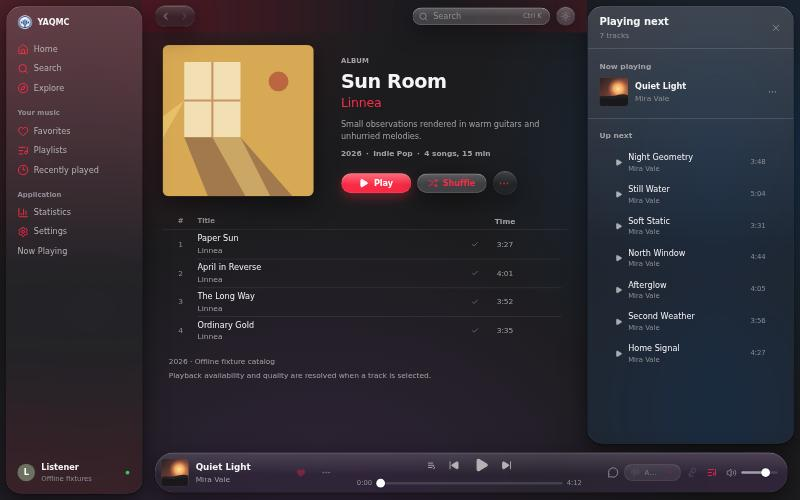
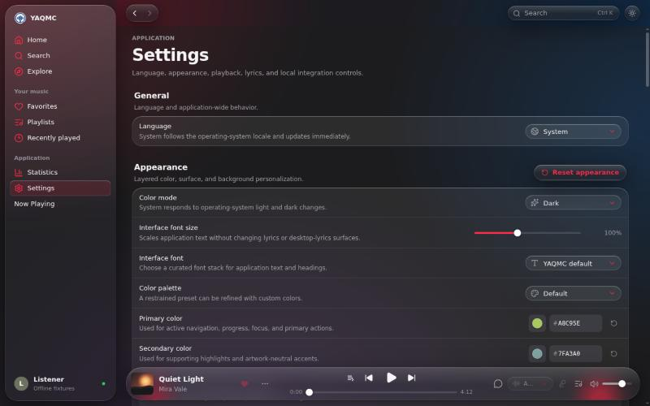
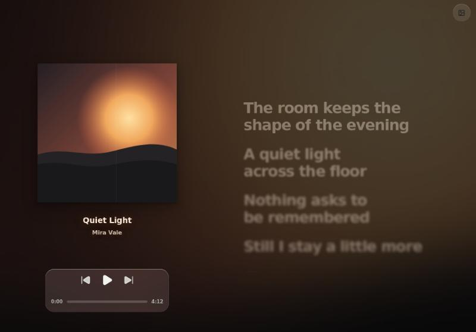
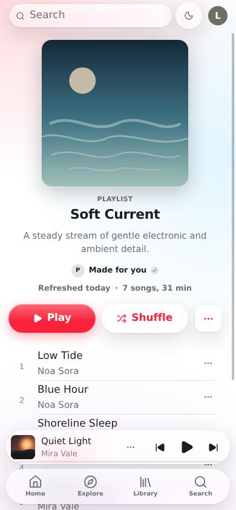

**Desktop** — album with Up Next docked, Settings, Now Playing, dark Explore

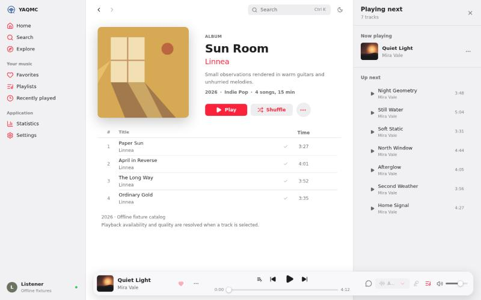
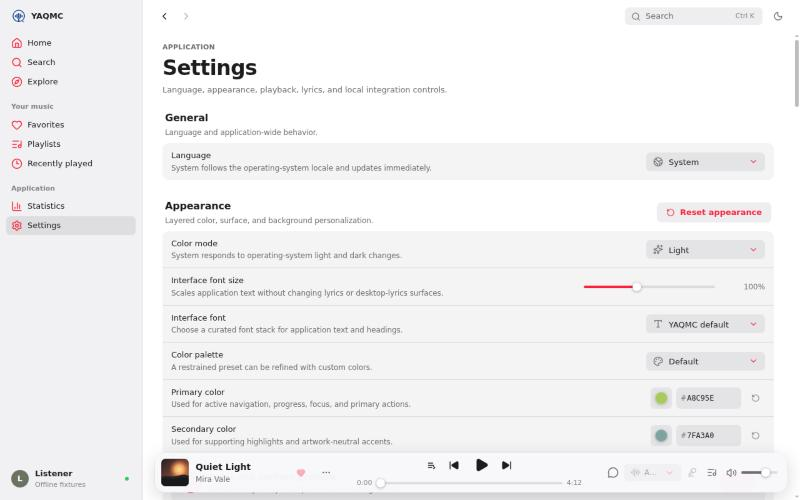
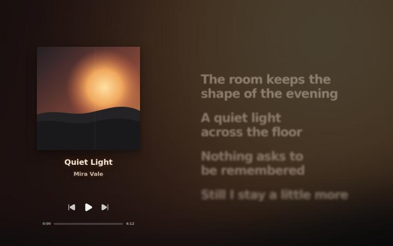
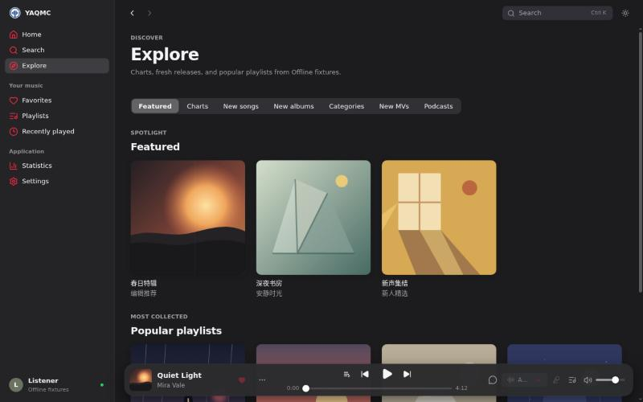

**Tablet** — two-pane album, grouped Settings, portrait rail

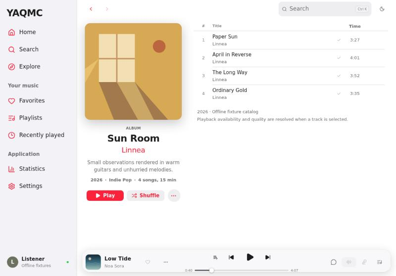
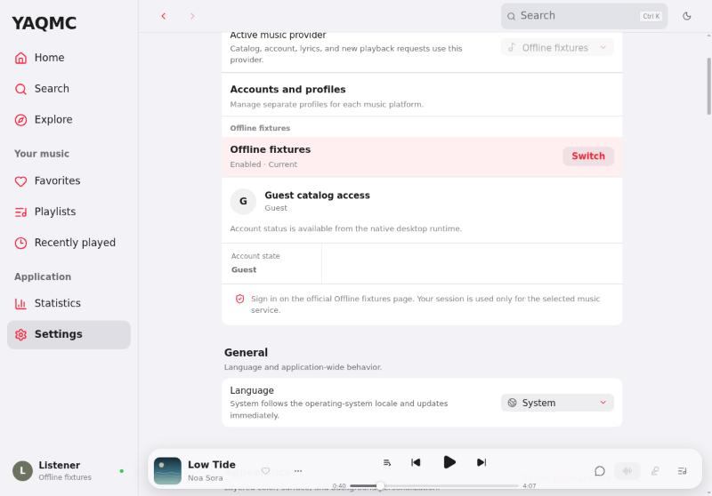
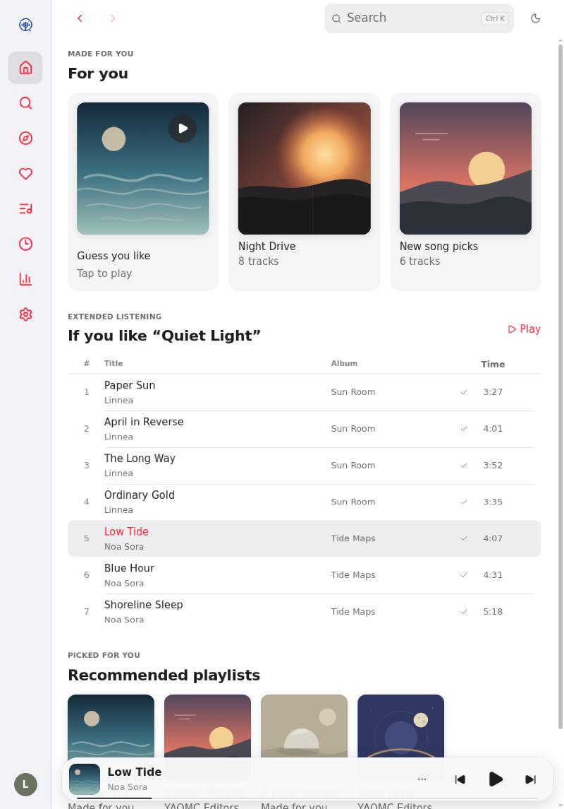

**Phone** — playlist, Library, Now Playing (no-lyrics state), dark Settings

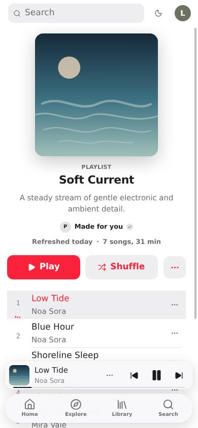 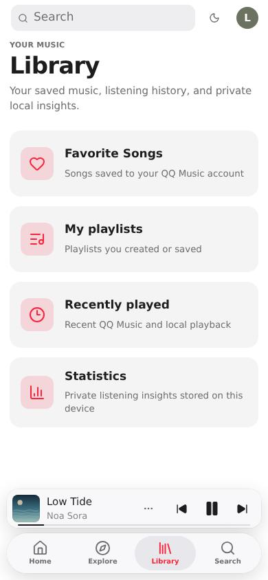 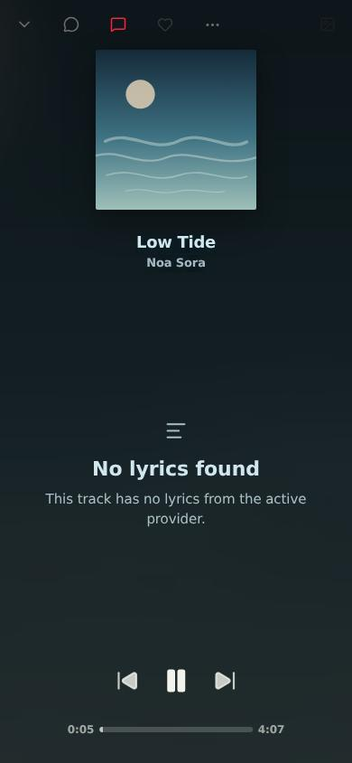 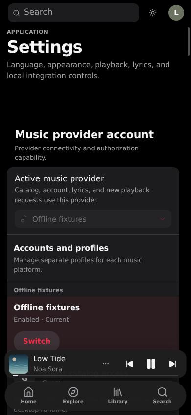

Captured from the YAQMC 0.1.1 web client with its offline fixture provider and the stylesheets inserted
directly, on Linux (so the typeface is a fallback; on Apple devices the host's font stack resolves to San
Francisco). Screenshots from the installed plugin in the real app are in
[`docs/verification/`](docs/verification/).

</details>

## Install

1. Download `dev.cupertino.yaqmc-1.1.0.yaqmc-plugin` from the [latest release](../../releases/latest).
2. In YAQMC open **Settings → Plugins → Choose file** and pick the package.
3. Review the SHA-256 and the permissions below, then **Enable**. The redesign applies immediately;
   disabling the plugin restores the stock interface.
4. Optional: install `dev.cupertino.yaqmc.now-playing-1.1.0.yaqmc-plugin` the same way for the Now
   Playing page.

**Updating from 1.0.0:** disable Cupertino, choose the 1.1.0 package (YAQMC offers it as an update and
lists the permissions it drops), confirm, enable. The Style setting of 1.0.0 is gone; use Material.

Optional, all in YAQMC's own settings:

- **Appearance → Material**: **Opaque** is Classic, **Translucent** is Liquid Glass. Switches live.
- **Lyrics presets → Cupertino** selects the bundled Now Playing scene (artwork rests smaller while paused).
- **Appearance → Color palette**: the host's default palette becomes the Music red; any other palette you
  pick is respected as is.
- **Plugins → Cupertino Now Playing → Home arrangement**: Default, Stations first, or Essentials only.

### Compatibility

Plugin API v4 is required: **YAQMC 0.1.1 or newer** (`engines.yaqmc: ">=0.1.1"`).

| Checked | How | Result |
| --- | --- | --- |
| YAQMC 0.1.1 desktop (`3563bac`), Electron 43, Linux | Installed through the host's install, update and enable flow into an isolated QA profile with the real Core; [`tools/host-check.mjs`](tools/host-check.mjs) | 35/35 checks pass ([report](docs/verification/yaqmc-0.1.1-3563bac/report.json)) |
| Same, with the host fix below | Same | 35/35 checks pass ([report](docs/verification/yaqmc-0.1.1-3563bac-host-fix/report.json)) |
| 0.1.3-beta.3 | Class names checked in source only (1.0.0) | Not run |
| Windows, macOS, Android hosts | — | **Not verified.** The Android and tablet layout systems were only exercised at those widths inside the Electron host |

**Why 1.0.0 did not apply in the real app.** Core returned all nine stylesheets and the renderer inserted
them, then `startScripts` started the plugin's worker and, before doing so, called `retireOnePlugin`, which
removes every `style[data-yaqmc-plugin-style]` node of that plugin
(`src/application/plugin-runtime.ts`, since `c870878`). Style-only plugins are unaffected, a plugin with
styles *and* a script loses its CSS on every launch and enable. 1.1.0 avoids it by shipping the redesign
without a script. A host fix (worker restarts keep resource-owned style nodes, with a regression test) is
on the YAQMC branch `fix/plugin-restart-keeps-styles`; with it, 1.0.0 also renders (verified), but 1.1.0
does not need it.

### Permissions

| Package | Permission | Why |
| --- | --- | --- |
| Cupertino | `style.register`, `scene.register` | The redesign itself and the Cupertino lyrics scene |
| Now Playing | `ui.pages`, `ui.navigation` | The host-rendered **Now Playing** page and its sidebar entry |
| Now Playing | `track.read`, `player.read`, `lyrics.read` | Content of that page |
| Now Playing | `player.control` (sensitive) | Its Previous / Play / Next buttons and tap-a-lyric-to-seek |
| Now Playing | `ui.layout` | Applying the Home arrangement setting |

No network, storage or account access.

## Styles

| | Classic (Material: Opaque) | Liquid Glass (Material: Translucent) |
| --- | --- | --- |
| Canvas | Plain system background | Soft accent / blue / purple wash for the glass to refract |
| Sidebar | Full-height source list | Inset floating glass pane with rounded corners |
| Bars, sheets, menus | Dense tint | Real backdrop blur on every platform, specular top rim, capsule shapes |
| Controls | Filled tints, rounded rectangles | Pills; primary buttons lit from above; segmented controls and selects as glass tracks |
| Content cards | Flat fills | Tinted panes with a light rim, deliberately unblurred |

Liquid Glass falls back to solid chrome when the system asks for reduced transparency. It re-enables
live blur that the host turns off on Windows, Linux and Android for repaint cost, but only on the small
floating surfaces; if playback feels heavy on a slow GPU, use Classic.

## The three layout systems

| | PC — macOS | Phone — iOS on Android | Tablet — iPadOS |
| --- | --- | --- | --- |
| Applies to | Electron / browser at ≥600px | Any host below 600px | Android at ≥600px |
| Navigation | Full-height source list, accent glyphs, unified toolbar | Floating tab bar; search field and account in the navigation bar | Sidebar with a large title in landscape, icon rail in portrait |
| Player | Floating Now Playing bar; content scrolls beneath it | Mini player capsule stacked above the tab bar | Floating bar spanning content and panes |
| Panes | Up Next docks as a third column from 1240px, popover below | Up Next and comments are bottom sheets with a grabber | Up Next docks from 1180px; album, playlist and song pages pin their header beside the track list |
| Lists and controls | 44px table rows, hover menus highlighted in accent, 32px push buttons | 56px rows, 46px menu rows, horizontal snapping shelves, large titles | 54px rows, grouped white cells on a gray canvas |
| Platform fit | Reserves the macOS traffic-light corner; keeps Windows/Linux caption buttons | System back drives history (no back chevron), bars sit above the gesture inset, OLED black in dark mode | Hardware volume replaces the on-screen slider; safe-area insets on every edge |

Shared by all three: an Apple system palette in light and dark, segmented controls, iOS switches, thin
sliders with a white knob, borderless grouped Settings, a hairline that appears under the top bar once
content scrolls, and reduced-motion support.

### Coverage

| Surface | Redesigned through |
| --- | --- |
| Sidebar, top bar, player bar, bottom navigation | Layout stylesheets |
| Home, Explore, Area | Shelves, tiles, section headers; Home section order via `ui.layout` |
| Search | Search field, segmented scopes, result tables and grids |
| Library, Favorites, Playlists, Recently played | Cards, grids, profile, pagination |
| Album, Playlist, Artist, Song | Plain artwork header with accent artist, action row, track table; two-pane on tablets |
| Queue (Up Next) | Popover, docked pane or bottom sheet depending on layout |
| Lyrics / Now Playing | Transport, scrubber, chrome; the **Cupertino** scene; the **Now Playing** plugin page with a tappable lyric index |
| Comments | Inset inspector on wide screens, page sheet on phones |
| Settings, Statistics, Plugins, plugin pages | Grouped lists, tabs, metric cards |
| Menus, selects, dialogs, notices | Shared components |
| Loading, empty and error states | Skeletons, empty states, error notices, "No lyrics", unsupported comments |

Not covered: the separate Desktop Lyrics and Lyrics Island windows, and the Lyrics Composer editor canvas.

## Host API limitations

What the plugin API allows shaped this design. The constraints that matter:

1. **No markup.** Plugins cannot add, move or reorder host DOM. So there is no way to put a queue button
   on the phone mini player (the host hides it there), add or reorder tab bar items, collapse a large
   title into the navigation bar, add swipe gestures, show artwork thumbnails in track rows, or split
   Settings into a category list and a detail pane.
2. **The documented Style API is four selectors and five tokens.** A full redesign has to target the
   host's own class names, which YAQMC explicitly does not guarantee across releases. `npm test` keeps
   the package valid, and the classes were checked against 0.1.3-beta.3, but a future host refactor can
   break parts of the look. Disabling the plugin always restores the stock UI.
3. **Plugin CSS lives in a cascade layer below the app's unlayered CSS and inline theme tokens.** Every
   declaration therefore ships as `!important` (the build adds it). Side effects: a keyframe cannot
   animate a property the plugin also declares, and the user's accent can only be respected by leaving
   it alone, which is why the Music red applies to the default palette only.
4. **No plugin setting reaches CSS**, and on 0.1.1 a styled plugin cannot also have a script (see
   [Compatibility](#compatibility)). So the style switch is the host's own Appearance → Material, which
   the host writes onto `<html data-material>` on every platform. 1.0.0 instead flagged the style through
   the Now Playing entry's `aria-label`; the real host renders that label as `title`, and Android renders
   no plugin entries at all, so it never worked outside a mock.
5. **Live blur is switched off by the host on Windows, Linux and Android** for rendering performance.
   Classic uses dense tints there; Liquid Glass opts back in on its floating surfaces.
6. **Plugin pages are block documents** (heading, text, stats, list, actions, notice, divider; 40 blocks,
   50 list items, no images or custom layout), and navigation entries only appear in the desktop sidebar's
   Plugins section. The Android host renders none, so on Android the Now Playing page is not reachable.
7. **Scripts see the current track, playback state and lyrics only.** There is no queue, library or
   search API, so the plugin page cannot show Up Next or browse content.
8. **`ui.layout` covers Home only**: three sections, order and visibility.
9. **Scenes are opt-in and read-only.** The plugin cannot select its scene for the user, and plugin
   scenes cannot be edited in the Composer (fork it instead).
10. **No device class signal and no iOS host.** Layouts key off `data-host-kind` plus width, so a
    large foldable in a narrow window gets the phone system, by design.
11. **No bundled or network fonts.** San Francisco is used where the OS provides it.

## Architecture

```
manifest.json            Cupertino: styles and scene only
now-playing.manifest.json  Cupertino Now Playing: script, permissions, settings schema
styles/00-tokens.css     colour, shape, motion, type ramp (re-points host tokens)
styles/10-foundation.css shared components: buttons, sliders, menus, tables, sheets, states
styles/20-pages.css      page compositions shared by every layout
styles/30-now-playing.css  lyrics stage transport and comments
styles/40-layout-pc.css    layout system 1: macOS
styles/41-layout-phone.css layout system 2: iOS on Android
styles/42-layout-pad.css   layout system 3: iPadOS
styles/50-platform-ios.css entry point for a future iOS host
styles/60-liquid-glass.css Liquid Glass, scoped under :root[data-material='translucent']
scenes/cupertino.*       lyrics scene (schema + scoped CSS)
main.js                  Now Playing page and Home arrangement (plain JS, no bundler)
tools/build.mjs          promotes declarations to !important, writes build/<id>/ and dist/*.yaqmc-plugin
tools/host-check.mjs     real-host install and computed-style check (see Development)
test/                    build transform, package rules, script behaviour
```

Layouts are written against size classes, not against Android: compact width goes to the phone system on
any host, regular width goes to the tablet system on touch hosts and to the PC system elsewhere.

### Adding iOS

YAQMC has no iOS host yet. When one reports `data-host-kind="ios"` and `data-platform="ios"`:

- iPhone and iPad already select the phone and tablet systems (`ios` is in their selectors) and the touch
  type ramp (`00-tokens.css`). None of this has run on an iOS host; there is none to test against.
- [`styles/50-platform-ios.css`](styles/50-platform-ios.css) is where iOS-only behaviour goes. It already
  restores the back chevron on phones (no system back gesture) and native rubber-band scrolling.
- Add `ios` to nothing else: `manifest.json` leaves `platforms` unset so the package is not excluded.

## Publishing

With an authenticated GitHub CLI:

```bash
tools/publish.sh
```

It creates the repository (topic `yaqmc-plugin`), pushes, and publishes Release `v<version>` with both
packages and `docs/release-notes.md`.

## Development

Requires Node.js 22.2 or newer; no dependencies.

```bash
npm run build
```

```bash
npm test
```

`build/<id>/` are the unpacked plugins (loadable with YAQMC's Developer Mode); `dist/` holds the
installable packages.

Real-host check (needs a YAQMC checkout with `node_modules`, `node apps/desktop/scripts/build.mjs --qa`,
a `yaqmc-core` binary and `npm run dev` running there):

```bash
node tools/host-check.mjs ../yaqmc docs/verification/run dist/dev.cupertino.yaqmc-1.0.0.yaqmc-plugin
```

It creates a throwaway QA profile, installs the previous package, updates to the current one through the
host's update transaction, installs the companion, then walks every primary page at desktop, phone
portrait, phone landscape and tablet sizes in light and dark, Classic and Liquid Glass, disables,
re-enables and cold-restarts, recording computed styles and screenshots. The real Core's music client
ignores process proxies, so behind a proxy its catalog stays empty; detail pages, playback, lyrics, queue
and comments are then covered by a supplementary pass on the host's offline fixture catalog with the
packaged stylesheets inserted the way the host does.

## License

MIT. Not affiliated with or endorsed by Apple Inc. or the YAQMC project; no Apple fonts, icons or artwork
are included.
